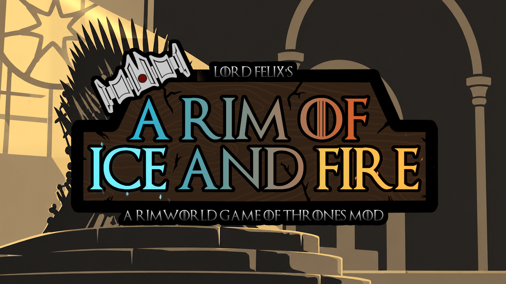

# A Rim of Ice and Fire

Welcome to Westeros.

Found a House of your own and carve out its place among the great families of the realm. Choose your words and sigil, raise your banners, and build a dynasty through loyalty, trade, marriage, or conquest.

**A Rim of Ice and Fire** brings the lands, cultures, and feudal life of Westeros to RimWorld, drawing inspiration from *A Song of Ice and Fire* and *Game of Thrones*, with book geography guiding the world map.

[Steam Workshop](https://steamcommunity.com/sharedfiles/filedetails/?id=3802324434) · [Discord](https://discord.gg/2Jeeu9jcfy) · [Support development](https://ko-fi.com/lordfelix69)

## Build your dynasty

- **Create your House.** Choose its name, words, home region, heraldry, and colors. Appoint a House Head and heir, arrange marriages, and navigate rivalries between families.
- **Rule your lands.** Welcome smallfolk, establish villages, and develop towns and garrisons. Collect taxes, manage obligations, and trade through stocked market stands.
- **Shape the realm.** Negotiate treaties, swear fealty, and call your levies when diplomacy fails.
- **Explore Westeros.** Meet the Great Houses and lesser Houses in a world shaped by regional cultures, rivers, and ancestral seats.
- **Equip your household.** Craft Westerosi weapons and armor, customize tabards and banners, and seek unique Valyrian-steel relics. Enable Industrialised Westeros to give newly recruited regional soldiers firearms.

## Getting started

The mod supports **RimWorld 1.6 and 1.7** and requires **[Harmony](https://steamcommunity.com/sharedfiles/filedetails/?id=2009463077)**. Expansions are optional; their related content becomes available when the corresponding DLC is active.

To install from this repository:

1. Choose **Code → Download ZIP** on GitHub and extract the archive.
2. Place the extracted mod folder inside your RimWorld `Mods` directory. `About`, `Assemblies`, `Textures`, and `LoadFolders.xml` should sit directly inside that folder.
3. Enable Harmony and **A Rim of Ice and Fire** in RimWorld's mod list, with Harmony loaded before this mod.
4. Use the mod's custom starting scenario to begin in Westeros.

## Playing with other mods

Optional integrations are included for Combat Extended, Pillage and Plunder, World Domination 2, The Long Night, Medieval Overhaul, and ReGrowth 2. Weapon profiles are also included for Show Me Your Hands, Melee Animation, and Flourish.

The Long Night is a separate, optional companion mod. Dragons are not included in this module.

## Join the community

This is a solo project by **lordfelix**, and it continues to grow. Join the [Discord server](https://discord.gg/2Jeeu9jcfy) to share ideas, follow development, and report problems. A description of what happened, a screenshot, and your `Player.log` help when tracking down an issue.

If you'd like to support ongoing development, you can find me on [Ko-fi](https://ko-fi.com/lordfelix69).

## About this repository

This repository contains the installable mod, including its compiled assemblies. The C# source project is not included.

See [LICENSE](LICENSE) for the MIT license.

A Rim of Ice and Fire is an unofficial fan-made RimWorld mod. It is not affiliated with or endorsed by George R. R. Martin, HBO, Warner Bros., or Ludeon Studios. All respective trademarks and intellectual property belong to their owners.
